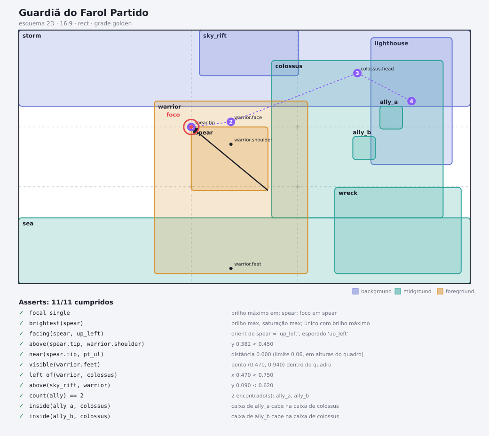
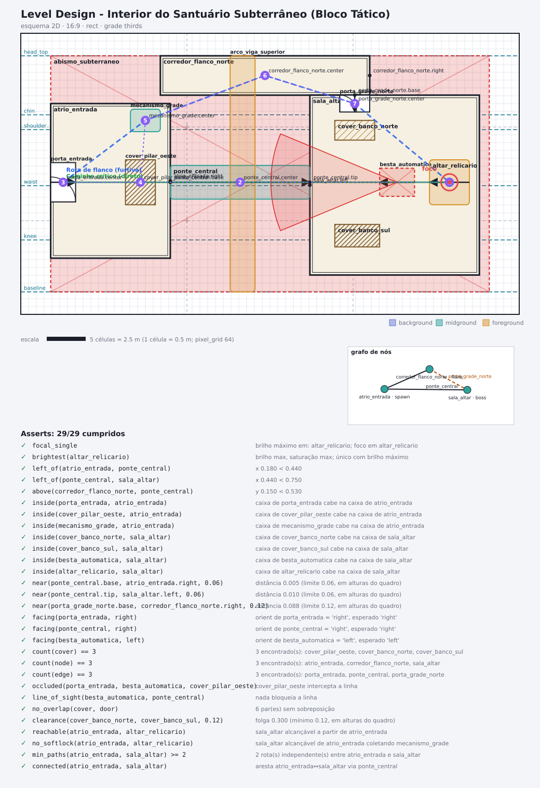

# scenelang — linguagem de programação para descrição de imagens

> A cena é o código-fonte; o prompt é o binário.

**scenelang** é uma linguagem declarativa (YAML) para descrever uma imagem como uma cena estruturada.
Um compilador transforma a cena em prompt para qualquer modelo de imagem; verificadores em código
medem o resultado. A linguagem declara a intenção e o modelo tenta: cada falha medida é dado de avaliação e de treino.



## Instalação

```
pip install -e .[dev]
scenelang validate examples/guardia.yaml
scenelang compile examples/guardia.yaml --target prose
```

## Como as peças se encaixam

```
cena.yaml ─► expand (at, preset, auto_asserts, safe_zones) ─► validate ─► IR ─┬─► prose / compact / json / regions ─► modelo de imagem
   ▲                                                                          │        (relatório de perdas por destino)
   │                                                                          ├─► render (esquema 2D · planta baixa)
   │                                                                          ├─► pack (prompt + guia, manifesto com hash)
   │                                                                          └─► level (mermaid · tiled · godot · unity)
   │
   └── correct ◄── Finding ◄── verify / locate (imagem) ── medição com confiança ── diff · patch · delta-prompt (edição incremental)
        (regra por falha, histórico, escalada, adiamento se a evidência é fraca)
```



## Camadas da linguagem

| Camada | Chaves | O que controla |
|---|---|---|
| Quadro e grade | `canvas` (rect/circle/ellipse, `pixel_grid`), `grid` (áurea, terços) | formato, grade de pixels, pontos de interesse |
| Entidades | `entities` (box/at, `orient`, `brightness`, `saturation`) | posição, plano, direção, foco |
| Cor | `colors`, `palette` (`mode: fixed\|model_picks`, RGB/CMYK/HSL, harmonia, contraste) | cores exatas ou escolhidas pelo modelo |
| Guias | `guides` (cânone de cabeças, eixo, linhas, margem; `model_proposes`) | proporção e consistência |
| Fundo | `background` (`chromakey`, `alpha: chroma\|difference`) | recorte e canal alfa |
| Atmosfera | `atmosphere` (mood, clima, vento), `wind_parts` | coerência entre objetos leves e o vento |
| Materiais | `materials`, `material`/`parts` (tecido, trama, caimento, escamas), `detail` | textura por parte e orçamento de detalhe |
| Personagem | `entities[].character` (idade, herança, tom de pele, cabelo, olhos, rosto, corpo, partes) | biotipo descrito atributo por atributo, sem inferências |
| Intenção e olhar | `intent`, `gaze`, `lights`, `camera` | foco e ordem de leitura |
| Verificação | `asserts` (layout), `verify` (imagem) | critérios mensuráveis |
| Reuso | `extends`, `import`, `lock` | variantes, bibliotecas e partes travadas |
| Atalhos (v0.8) | `at` relativo, `auto_asserts`, `pose.preset` | posição por relação, ordem inferida das caixas, pose-base com ajuste fino |
| Relações (v0.8) | `interactions`, `safe_zones` | como duas entidades interagem; onde NÃO pode haver elementos |
| Pose (v0.7) | `pose` em graus, perfil anatômico, rig (`unity_humanoid`, `mixamo`) | manequim e frases de pose por junta |
| Level design (v0.9) | `graph`, `flow`, `guides.metrics`, predicados de visão/folga/alcançabilidade | mapas, interiores, rotas, cones de visão, softlock |

Referência de vocabulário: [`docs/LANGUAGE.md`](docs/LANGUAGE.md).

Representação independente de destino (experimental): [`docs/UNIVERSAL_SCENE_IR.md`](docs/UNIVERSAL_SCENE_IR.md).

## Comandos

| Comando | O que faz |
|---|---|
| `validate CENA [--json]` | Valida tudo numa passada, com caminho, valores aceitos e "você quis dizer…". |
| `compile CENA --target prose\|json\|regions [--pass black\|white]` | Compila a cena. Negações viram afirmações. |
| `check CENA` | Avalia os asserts de layout (sem imagem). |
| `render CENA --out F.png` | Esquema 2D: grade, caixas, orientação, guias, olhar, foco. |
| `plan CENA` / `plan-apply CENA PROPOSTA` | Pedido estruturado ao modelo (cores e guias) e gravação da proposta, já validada. |
| `verify CENA IMAGEM` | Mede a imagem: cores, grade de pixels, simetria, guias, paleta, fundo, vazamento. |
| `cutout CENA IMAGEM --out F.png` / `cutout --black B --white W --out F.png` | PNG com alfa (por chave ou por diferença de duas passadas). |
| `sweep CENA --axis caminho=v1,v2,v3 --out DIR` / `sweep-score FICHA` | Variantes que mudam um eixo só; mede se a imagem seguiu a ordem. |
| `eval-form` / `eval-apply [--lock-passed]` | Ficha de avaliação, reforço do que falhou e trava do que passou. |
| `snap CENA IMAGEM --out F.png [--grid N --colors N --to-palette --fit]` | Pixel art de verdade: grade, cores, paleta exata, encaixe nas guias, fundo transparente. |
| `sheet-prompt` / `sheet-measure` | Variantes lado a lado num prompt só e medida de cada coluna. |
| `primer` / `vocab [--json]` / `new [modelo]` | Cartilha de uma página, vocabulários e cenas iniciais para o modelo escrever cenas. |
| `compile … --target compact --token-budget N` | Poda o prompt por prioridade até caber em N tokens e declara o que saiu como perda. |
| `pack CENA [--strict --guide-style blocks\|seg]` / `unpack --check` | Prompt + guia (ou PNG único) com manifesto e hash canônico; confere a integridade na volta. |
| `locate` / `correct` | Localiza entidades na imagem (5 estados, com confiança) e gera o próximo prompt de correção, com histórico. |
| `diff` / `patch` / `delta-prompt` | Compara cenas, aplica edições endereçadas e escreve só o prompt do que mudou. |
| `pose --export unity_humanoid\|mixamo` | Folha de pose e exportação de nomes de ossos (sem calibração). |
| `render CENA --style floorplan` | Planta baixa: paredes duplas, portas, coberturas, rotas, cones, escala e grafo. |
| `level CENA --export mermaid\|tiled\|godot\|unity` | Exporta o grafo e o blockout. |
| `bench plan\|record\|report` | Estrutura de benchmark (convencional × completa × compacta × incremental); métricas offline. |
| `scenelang-mcp` | Servidor MCP: o modelo escreve, valida, compila, mede e corrige sem copiar arquivos. Há também `skill/scenelang/SKILL.md`. |
| `validate --fix [--out F]` | Aplica as correções seguras que o validador propõe (typos de valor e de campo). |

## Regras importantes

- Direções são do ponto de vista de quem vê a imagem (`left` = esquerda da tela), inclusive o vento.
- Coordenadas normalizadas: x para a direita, y para baixo, `[0,1]`.
- Pontos de interesse da grade saem com porcentagens ("a cerca de 38% da esquerda e 38% do topo"), porque os modelos leram "superior esquerdo da grade" como o canto do quadro.
- Foco único: só um elemento com `brightness: max`; só um ponto com detalhe `max`.
- CMYK → RGB é aproximado (sem perfil ICC); a cor impressa real depende do perfil.
- Elementos translúcidos (vidro, fumaça, brilho) recortam mal por chave; use `alpha: difference`.
- `eval-apply` regrava o YAML sem os comentários originais.
- Os verificadores de imagem exigem Pillow e numpy (`pip install scenelang[image]`).

## Exemplos

- `examples/guardia.yaml` — splash art 16:9, grade áurea, 11 asserts.
- `examples/emblema.yaml` — quadro circular, grade de terços, `count` com glossário.
- `examples/pixel_heroi.yaml` — pixel art 32×32 com paleta escolhida pelo modelo, guias, chromakey, vento, materiais e 7 verificadores.
- `examples/dragoa_e_cavaleira.yaml` — escrita por um modelo pequeno só com a cartilha: escamas com degradê, personagem com tom de pele, capa ao vento.
- `scenelang new sprite|splash|emblem|character-sheet` — cenas iniciais que já validam sem avisos.
- `examples/pixel_heroi_noite.yaml` — variante por `extends` + biblioteca de materiais + travas.
- `examples/interior_santuario_level.yaml` — level design: grafo com porta trancada, rotas, cone de visão, métrica em células e 29 asserts (visão, cobertura, folga, softlock, caminhos independentes).
- `examples/minecraft_dungeon_puzzle.yaml` — dungeon de quebra-cabeça para Minecraft (1 célula = 1 bloco, 3 puzzles encadeados por chaves, 54 asserts, `requires` e `no_softlock`).

## Status

**Versão 0.9 (experimental).** 428 testes passando, 4 ignorados (Python 3.15 neste checkout; a suíte ainda não foi executada em 3.10, o mínimo declarado). O IR universal está documentado como recurso experimental v1. Histórico: [`docs/AUDITORIA.md`](docs/AUDITORIA.md) (auditoria v0.5→v0.7), [`docs/LANGUAGE.md`](docs/LANGUAGE.md) (referência) e [`docs/UNIVERSAL_SCENE_IR.md`](docs/UNIVERSAL_SCENE_IR.md).

**O que já foi medido**
- Um teste de ponta a ponta com duas rodadas (relatório de campo, v0.7.1): na primeira, 5 de 6 restrições espaciais; após `correct`, 6 de 6. É **um caso**, não estatística.
- `delta-prompt` reduziu um prompt de 6.625 para 442 caracteres numa edição pontual.
- Defeitos reais achados e corrigidos pelos testes: manequim com sinais invertidos, hash não canônico, correção falsa por medição fraca por cor.

**O que ainda não está provado ou pronto**
- O benchmark contra um gerador real **não foi executado**: não há número de redução de tentativas ou de custo. O prompt completo gasta mais tokens de entrada que um prompt ingênuo (~3,7× no exemplo do sapo mago; use `--token-budget` ou o destino `compact`).
- `seg` desenha retângulos, não máscaras; localizar por cor é frágil (por isso o sistema recusa decidir quando a evidência é fraca).
- Conversão de pose para rigs traz só os nomes dos ossos, sem calibração; o manequim tem proporções humanas.
- Exportador Godot (`.tscn`) não foi aberto no Godot; LDtk não é suportado.
- `safe_zones` aparece no esquema, mas ainda não no guia do `pack`.

A linguagem é neutra quanto a fornecedor e não contém mecanismos para contornar políticas de uso de modelos.
