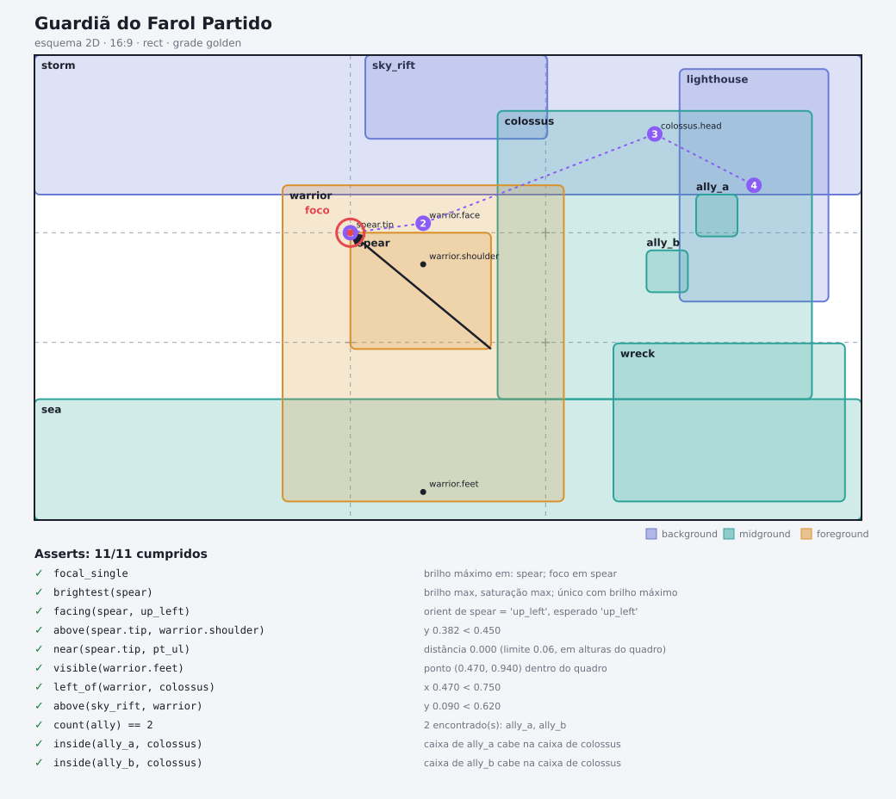
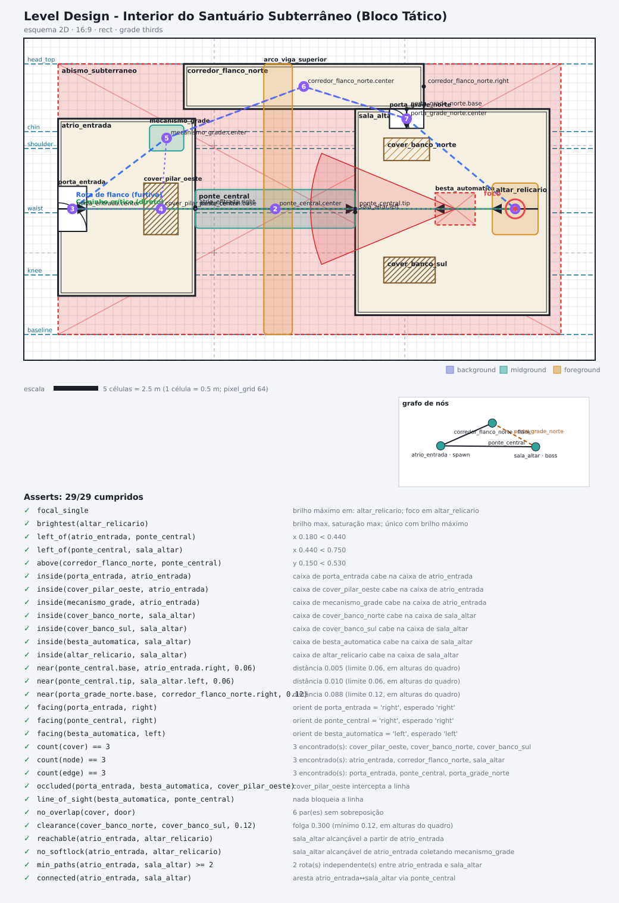

# scenelang — a declarative scene language for image generation

> 🇧🇷 [Versão em português](README.pt-BR.md) · English (this page)

> The scene is the source code; the prompt is the binary.

**scenelang** is a declarative language (YAML) that describes an image as a structured scene. A compiler turns the
scene into a prompt for any image model; code-based verifiers measure the result. The language **declares intent and
lets the model try**: every measured failure becomes a structured record
(see [`docs/DATA.md`](docs/DATA.md) — what is recorded, and what is **not** proven).



**Status: v0.9, experimental.** Evidence so far is small and author-run; see [Status](#status).
Language note: scene vocabulary and generated prompts are in Portuguese; the CLI messages are Portuguese too.
The YAML keys, the docs in `README.md` / `docs/DATA.md` and the code are English-friendly; translating the rest is open work.

## Install

```
pip install -e .[dev]
scenelang validate examples/guardia.yaml
scenelang compile examples/guardia.yaml --target prose
```

## How the pieces fit

```
scene.yaml ─► expand (at, preset, auto_asserts, safe_zones) ─► validate ─► IR ─┬─► prose / compact / json / regions ─► image model
   ▲                                                                           │      (loss report per target)
   │                                                                           ├─► render (2D schematic · floor plan)
   │                                                                           ├─► pack (prompt + guide, manifest with hash)
   │                                                                           └─► level (mermaid · tiled · godot · unity)
   │
   └── correct ◄── Finding ◄── verify / locate (image) ── measurement with confidence ── diff · patch · delta-prompt
        (one rule per failure, history, escalation, deferral when evidence is weak)

project/  projeto.yaml · telas/ · refs/ · relatorios/  ──►  scenelang project export  ──►  data.jsonl
```



## The three loops

| Loop | Commands | What you get |
|---|---|---|
| **Declare** | `validate`, `check`, `render` | A scene whose constraints are checked on the layout *before* any image exists. |
| **Measure** | `pack`, `locate`, `verify`, `correct` | The generated image is measured per constraint (pass / fail / **not measured**), and the next prompt is built from the failures. |
| **Record** | `project round`, `project export` | One self-contained JSONL record per round: scene, prompt, image hash, per-constraint results, corrections. |

## Language layers

| Layer | Keys | Controls |
|---|---|---|
| Canvas and grid | `canvas` (rect/circle/ellipse, `pixel_grid`), `grid` (golden, thirds) | shape, pixel grid, points of interest |
| Entities | `entities` (box/`at`, `orient`, `brightness`, `saturation`) | position, plane, direction, focus |
| Color | `colors`, `palette` (`fixed` or `model_picks`, RGB/CMYK/HSL, harmony, contrast) | exact or model-chosen colors |
| Guides | `guides` (head-count canon, axis, lines, margin; `model_proposes`) | proportion and consistency |
| Background | `background` (`chromakey`, `alpha: chroma\|difference`) | cut-out and alpha channel |
| Atmosphere | `atmosphere` (mood, weather, wind), `wind_parts` | coherence between light objects and wind |
| Materials | `materials`, `material`/`parts` (fabric, weave, drape, scales), `detail` | per-part texture and detail budget |
| Character | `entities[].character` (age, heritage, skin tone, hair, eyes, face, body, parts) | attribute-by-attribute body description, no inference |
| Intent and gaze | `intent`, `gaze`, `lights`, `camera` | focus and reading order |
| Verification | `asserts` (layout), `verify` (image) | measurable criteria |
| Reuse | `extends`, `import`, `lock` | variants, libraries, locked parts |
| Shortcuts (v0.8) | relative `at`, `auto_asserts`, `pose.preset` | placement by relation, order inferred from boxes, base pose with fine tuning |
| Relations (v0.8) | `interactions`, `safe_zones` | how two entities interact; where nothing may appear |
| Pose (v0.7) | `pose` in degrees, anatomical profile, rigs (`unity_humanoid`, `mixamo`) | mannequin and per-joint pose phrases |
| Level design (v0.9) | `graph`, `flow`, `guides.metrics`, visibility / clearance / reachability predicates | maps, interiors, routes, sight cones, softlock |
| Workspace | `project` | where each screen lives, what was measured, what is next |

Vocabulary reference: [`docs/LANGUAGE.md`](docs/LANGUAGE.md) (Portuguese).
Target-independent representation (experimental): [`docs/UNIVERSAL_SCENE_IR.md`](docs/UNIVERSAL_SCENE_IR.md).

## Commands

| Command | What it does |
|---|---|
| `validate SCENE [--json]` | Validates everything in one pass, with path, accepted values and "did you mean…". |
| `compile SCENE --target prose\|json\|regions\|compact [--token-budget N]` | Compiles the scene. Negations become affirmations; the budget prunes by priority and declares what was dropped. |
| `check SCENE` | Evaluates layout asserts (no image needed). |
| `render SCENE --out F.png [--style floorplan]` | 2D schematic or floor plan: grid, boxes, orientation, routes, sight cones. |
| `pack SCENE [--guide-style blocks\|seg]` / `unpack --check` | Prompt + composition guide with a hashed manifest; integrity check on the way back. |
| `locate` / `correct` | Locate entities in the image (5 states, with confidence) and write the next correction prompt, with history. |
| `verify SCENE IMAGE` | Measure the image: colors, pixel grid, symmetry, guides, palette, background, spill, quiet zones, walkable connectivity. |
| `project init\|layer\|add\|status\|round\|export\|report` | Workspace: where each screen lives, what is measured, what is next; `export` writes the dataset; `report` gives per-arm pass rates with intervals. |
| `annotate-form` / `reconcile SCENE ANNOTATION` | Independent measurement: an annotator describes the image without seeing the scene; the tool matches, re-checks asserts, counts, and lists extras. |
| `level SCENE --export mermaid\|tiled\|godot\|unity` | Export the graph and the blockout. |
| `diff` / `patch` / `delta-prompt` | Compare scenes, apply addressed edits, write only the prompt of what changed. |
| `bench plan\|record\|report` | Benchmark scaffolding (conventional × full × compact × incremental); offline metrics. |
| `plan` / `plan-apply`, `eval-form` / `eval-apply`, `sweep`, `snap`, `cutout`, `sheet-*`, `pose` | Model-proposed colors and guides, evaluation forms, one-axis sweeps, true pixel art, alpha cut-outs, variant sheets, pose sheets. |
| `primer` / `vocab` / `new` | One-page primer, vocabularies and starter scenes for a model writing scenes. |
| `scenelang-mcp` | MCP server: a model can write, validate, compile, measure and correct without copying files. See also `skill/scenelang/SKILL.md`. |

## Conventions

- Directions are from the viewer's point of view (`left` = left of the screen), wind included.
- Normalized coordinates: x to the right, y downward, in `[0, 1]`.
- Grid points of interest are written with percentages, because models read "top-left of the grid" as the frame corner.
- Single focus: only one element with `brightness: max`.
- CMYK → RGB is approximate (no ICC profile).
- Translucent elements (glass, smoke, glow) cut out poorly by key; use `alpha: difference`.
- Image verifiers need Pillow and numpy (`pip install scenelang[image]`).

## Examples

- `examples/guardia.yaml` — 16:9 splash art, golden grid, 11 asserts.
- `examples/pixel_heroi.yaml` — 32×32 pixel art with a model-picked palette, guides, chromakey, wind, materials, 7 verifiers.
- `examples/dragoa_e_cavaleira.yaml` — written by a small model using only the primer.
- `examples/dark_fantasy_chefe.yaml` — boss-fight concept art: pose, interactions, quiet zone, atmosphere.
- `examples/interior_santuario_level.yaml` — level design: graph with a locked door, routes, sight cone, 29 asserts.
- `examples/minecraft_dungeon_puzzle.yaml` — Minecraft puzzle dungeon (1 cell = 1 block, 3 chained key puzzles, `requires`, `no_softlock`).
- `examples/dataset/sample.jsonl` — 3 sample records of the data format (boxes estimated by the author; shows the **format**, not a result).

## Status

**Version 0.9 (experimental).** 475 tests pass, 2 skipped (Python 3.15 in this checkout; the suite has not been run
on 3.10, the declared minimum).

**What has been measured (small, informal, author-run)**
- Minecraft dungeon, 3 images per arm, visual comparison: prompts compiled from the scene, with a composition guide,
  produced no invented UI panels (0/3) versus a hand-written prompt (3/3), and put the keys in the declared rooms (3/3).
  The hand-written baseline was written by the same author and did not mention those items.
- Boss-fight scene, 1 image per arm: compiled prompts reproduced per-entity details the hand-written prompt summarised
  away (moss on one pillar, chains on the other); the composition guide gave no clear extra benefit there.
- One end-to-end two-round test (v0.7.1): 5 of 6 spatial constraints on round one, 6 of 6 after `correct`. **One case**,
  not statistics.
- Real defects found and fixed by tests and fuzzing (malformed input crashing the validator; character-proportion lines
  leaking into a map prompt).

**What is not proven or not ready**
- **No statistical result.** 1–3 images per condition, two scenes; the generator was not recorded in those runs. Boxes
  were estimated by the author and are not independent.
- **No model has been trained on this data.** Usefulness for training is a hypothesis; see [`docs/DATA.md`](docs/DATA.md).
- The benchmark against a real generator has **not** been run at scale: there is no number for fewer attempts or lower
  cost. The full prompt uses more input tokens than a naive one (~3.7× on the frog-mage example; use `--token-budget`
  or the `compact` target).
- `seg` draws rectangles, not masks; locating by color is fragile (the system refuses to decide when evidence is weak).
- Pose-to-rig conversion carries bone names only, uncalibrated.
- The Godot exporter (`.tscn`) has not been opened in Godot; LDtk is unsupported.
- `safe_zones` appears in the schematic but not yet in the `pack` guide.
- The workspace has no reusable components, no layers with order/visibility, and no UI vocabulary yet.

The language is vendor-neutral and contains no mechanism to circumvent model usage policies.

## License

MIT.
